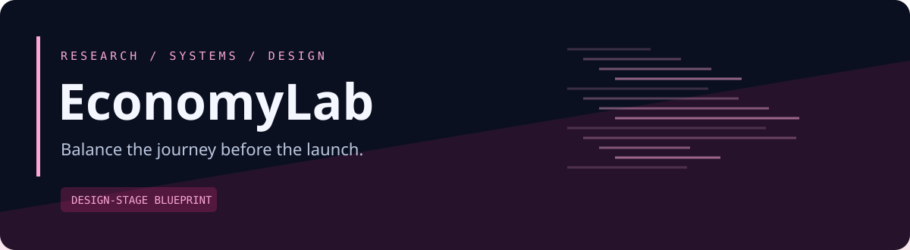
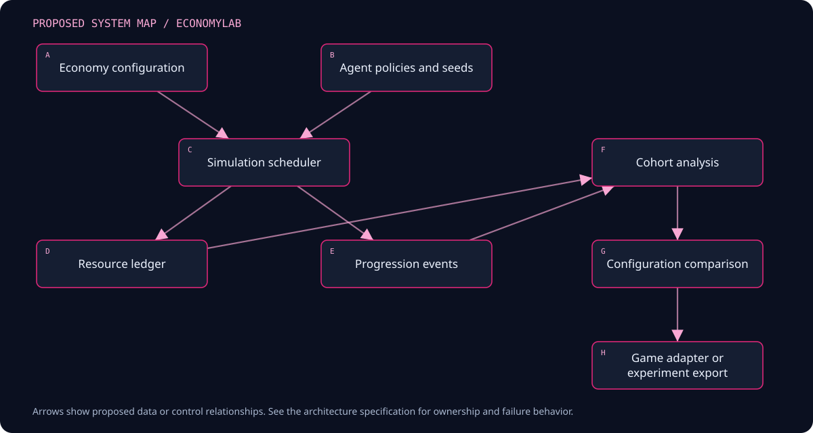

<p align="center"></p>

<p align="center"><strong>A simulation workbench for progression, rewards, and resource economies.</strong></p>
<p align="center">Design stage · Documentation first · Open design · No runtime implementation yet</p>

> **Status:** This repository contains an implementation blueprint, architecture, contract specifications, and validation plan. Features below are proposed. There is no installable application, measured performance, trading track record, or completed runtime test suite in this revision. Illustrative scenarios are design examples.

## The problem

An upgrade price may look reasonable in a spreadsheet but create long idle periods, runaway accumulation, or one dominant earning loop during play. Average milestone times can hide players who never reach a milestone. Live analytics describe observed outcomes but do not by themselves explain how a proposed configuration might behave.

## The proposal

Build a versioned discrete-event economy simulator with explicit agent policies, progression graphs, resource ledgers, and comparative reports. Begin with Roblox-style soft-currency economies and keep the core reusable for independent games. Treat synthetic player behavior as a testable assumption rather than a prediction of real players.

## A concrete walkthrough

A designer changes the price of the third upgrade and runs the old and new economies across the same seed set and three agent policies. The report shows completion distributions, unreached milestones, idle periods, balances, and resource sources/sinks. The designer opens a slow run to identify the affordability condition that stopped progress, then exports a candidate configuration for an isolated game test.

## Planned capabilities

| Capability | Why it matters |
| --- | --- |
| Versioned economy graph | Represent costs, rewards, unlocks, and prerequisites explicitly |
| Behavior-policy cohorts | Explore different choices and session schedules |
| Resource conservation | Explain currency creation, spending, inventory changes, and residuals |
| Paired configuration comparison | Use common random scenarios while preserving uncertainty |
| Progression diagnostics | Identify waiting, bottlenecks, unreachable goals, and dominant loops |
| Telemetry calibration | Compare modeled behavior with explicitly sourced playtest observations |

## System map



<details>
<summary>Editable Mermaid source</summary>

```text
flowchart TD
  A[Economy configuration] --> C[Simulation scheduler]
  B[Agent policies and seeds] --> C
  C --> D[Resource ledger]
  C --> E[Progression events]
  D --> F[Cohort analysis]
  E --> F
  F --> G[Configuration comparison]
  G --> H[Game adapter or experiment export]
```

</details>

The arrows describe proposed data or control relationships. Detailed ownership and error paths live in the architecture and pipeline specifications.

## Pipeline at a glance

| Stage | Result |
| --- | --- |
| Validate configuration | Accepted EconomyConfig |
| Instantiate cohort | Independent simulation initial states |
| Schedule actions | Ordered action and cooldown events |
| Apply transitions | Balances, inventory, unlocks, and flow events |
| Observe progression | Reached/unreached goals and waiting reasons |
| Compare scenarios | Distribution and sensitivity reports |
| Export and calibrate | Versioned candidate and model-fit notes |

## Proposed stack

| Layer | Choice | Reason |
| --- | --- | --- |
| Simulation core | Python discrete-event engine | Fast iteration and explicit event semantics |
| Numerical analysis | NumPy + pandas or Polars after profiling | Cohort distributions and sensitivity analysis |
| Artifacts | Parquet + immutable JSON manifests | Portable event and configuration evidence |
| Analysis UI | TypeScript + React + evaluated plotting library | Progression curves and scenario comparison |
| Roblox adapter | Luau configuration mapping | Explicit supported feature subset |
| Evidence adapter | TrailLedger-compatible manifest | Optional experiment lineage |

These are design decisions, not an installed dependency inventory. Exact versions, compatibility checks, and lockfiles will be added with the first implementation slice.

## First useful release

One soft currency, a small prerequisite graph, deterministic and probabilistic rewards, cooldowns, session boundaries, three transparent agent policies, paired-seed comparisons, unreachable-goal diagnostics, and a local report. Add a Roblox mapping only after the independent simulator is validated.

**Explicit boundaries:** No predicted player retention without empirical validation, real-money purchase optimization, randomized paid reward mechanics, universal Roblox telemetry export, complete behavioral simulation, or factory movement/queue scheduling. Ethical, platform, and audience implications of monetization are separate product decisions.

## Evidence before claims

Hand-solved deterministic economies must match event times and balances. Currency sources minus sinks must reconcile to balance change. Reports include the fraction of agents reaching milestones and uncertainty across independent runs. Model assumptions are assessed against playtests before behavioral claims.

## Documentation atlas

| Document | What it answers |
| --- | --- |
| [Product specification](docs/PRODUCT.md) | Users, scope, journeys, and measurable requirements |
| [Architecture](docs/ARCHITECTURE.md) | Components, ownership, state boundaries, and deployment |
| [Pipeline specification](docs/PIPELINE.md) | Stage inputs, outputs, checkpoints, and failure behavior |
| [Data model](docs/DATA_MODEL.md) | Entities, units, identities, lifecycle, and invariants |
| [Interfaces](docs/INTERFACES.md) | Integration contracts and domain-specific guarantees |
| [Experience design](docs/UX.md) | Screen behavior, navigation, and a distinctive visual direction |
| [Delivery roadmap](docs/ROADMAP.md) | Milestones with explicit exit criteria |
| [Validation and benchmarks](docs/VALIDATION.md) | Scenario matrix, correctness evidence, and measurement protocol |
| [Operations and recovery](docs/OPERATIONS.md) | Local deployment, diagnostics, recovery, and release behavior |
| [Ecosystem](docs/ECOSYSTEM.md) | Optional connections and independent operation |
| [Architecture decisions](docs/DECISIONS.md) | Choices, alternatives, consequences, and unresolved questions |
| [Source register](docs/SOURCES.md) | Primary references and implementation verification tasks |
| [Implementation handoff](docs/IMPLEMENTATION_HANDOFF.md) | Repository layout, bounded work packages, and review gates |
| [Contract conventions](docs/CONTRACTS.md) | Versioning, provenance, clocks, and numerical representation |
| [Simulation and calibration protocol](docs/SIMULATION_PROTOCOL.md) | Domain-specific protocol and worked design |

## Repository organization

| Present now | Planned with implementation |
| --- | --- |
| README, status, domain design documents | sim/ |
| Original SVG identity asset | analysis/ |
| Contribution and review templates | workbench/ |

See the [implementation handoff](docs/IMPLEMENTATION_HANDOFF.md) for the complete proposed module hierarchy. Planned directories are intentionally documented rather than filled with empty application scaffolding.

## Working with neighboring projects

TrailLedger can record simulation configuration and results. Shiftcraft can consume a narrow economy configuration and export supported progression events. Roblox integration uses declared Luau mapping and test telemetry rather than assuming arbitrary game scripts can be simulated.

All integrations are optional and proposed. The [ecosystem specification](docs/ECOSYSTEM.md) records contract direction, ownership, and the suggested order of integration. A local synthetic fixture must exercise this project's core behavior independently.

## Start here

1. Read the [product scope](docs/PRODUCT.md) and the first milestone in the [roadmap](docs/ROADMAP.md).
2. Review the domain invariants in the [data model](docs/DATA_MODEL.md).
3. Select one work package from the [implementation handoff](docs/IMPLEMENTATION_HANDOFF.md).
4. Produce the associated acceptance evidence before expanding scope.

There are no installation commands yet because no executable release exists. Future setup instructions must be verified from a clean environment.

## Contributing and project state

Use [CONTRIBUTING.md](CONTRIBUTING.md) for proposals and review expectations. [STATUS.md](STATUS.md) distinguishes the completed blueprint from planned engineering work.

**License:** MIT for original repository material; see [LICENSE](LICENSE). Third-party datasets, venue content, game assets, and trademarks retain their own rights.
