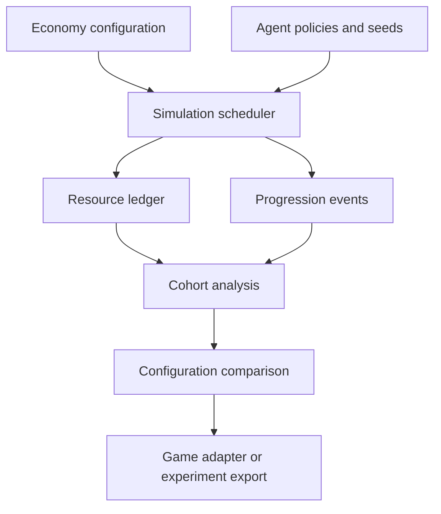

# EconomyLab — architecture

## Component boundaries

| Component | Owns | Boundary |
| --- | --- | --- |
| Config compiler | References, units, prerequisites, parameter validation | No automatic interpretation of arbitrary game scripts |
| Scheduler | Discrete time and event order | Independent from UI frame rate |
| Agent policy | Choice under visible simulated state | Behavior assumption is versioned |
| Resource reducer | Balances, inventories, unlocks | Atomic transition ownership |
| Cohort analyzer | Distribution, censoring, sensitivity | No silent survivor-only statistics |
| Game adapter | Supported configuration and event mapping | Platform feature subset declared |

## State, control, and computation

The economy graph describes permitted actions; the agent policy selects among eligible actions using its own recorded rules. The scheduler advances to the next meaningful event instead of iterating every rendered frame. Each run owns its resources, random streams, and event queue. Cohort runs can execute independently in parallel. Reward randomness, session timing, and policy exploration use separate named random streams so an unrelated configuration edit does not accidentally scramble every stochastic event.

## Deployment and dependency direction

The first deployment runs locally with explicit data and output directories. Domain logic must execute without a browser UI and without a sibling repository. The UI issues commands through an application boundary and reads materialized results; it never edits raw evidence or canonical domain state directly. File imports enter a staging area, validate, and only then become visible through a manifest.

Start with the fewest processes consistent with the domain. Add a process boundary when isolation, a different language runtime, or measured scheduling interference requires it. Do not introduce Kafka, Kubernetes, a shared remote database, or microservices to satisfy a diagram. Document resource limits, lock ownership, and crash recovery before adding concurrency.

## Fault containment

Invalid or unbounded behavior stops with an action trace and configuration reference. A zero-cost repeatable source can create an infinite loop; validation and event-budget guards identify it explicitly. A missing telemetry mapping creates incomplete calibration, not a plausible fitted model. Exports cannot claim compatibility with unsupported game features.

## Compatibility and observability

Domain interfaces are detailed in [INTERFACES.md](INTERFACES.md). Every run has an identity, a configuration fingerprint, a source revision, input references, and a terminal status. Diagnostic events link back to the smallest available unit of work. Structured logs carry correlation IDs and exclude credentials. Statistics state their units and observation windows. An operation that cannot establish input completeness must propagate that uncertainty rather than presenting a normal result.

## Extension rules

Adapters translate external formats at the boundary. They cannot redefine canonical semantics implicitly. A new source or execution adapter must pass the same fixture suite as the existing one and document unavailable capabilities. Cross-project contracts are accepted only after a synthetic round trip demonstrates version negotiation, duplicate behavior, and failure isolation.
